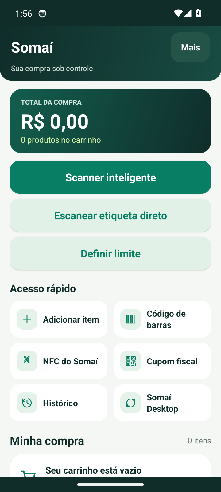
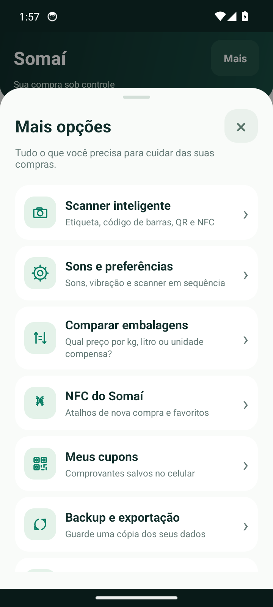
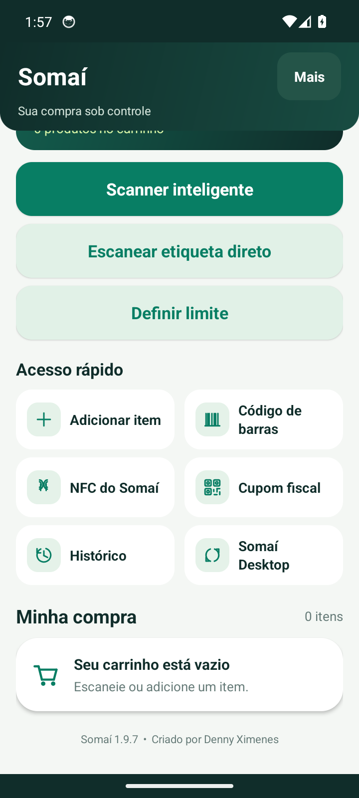

# Somaí
### Sua compra sob controle.

**Um jeito mais simples de acompanhar os produtos, conferir preços e organizar as compras no Android.**

[Conhecer o aplicativo](#sobre-o-somaí) · [Capturas reais](#capturas-reais-do-aplicativo) · [Baixar versão disponível](https://github.com/SrDanvers/somai-atualizacoes/releases/latest)

**Android • Português do Brasil • Sem anúncios • Sem cadastro**

---

## Em breve na Google Play

> **Lançamento oficial planejado.** O Somaí está em desenvolvimento e preparação para uma futura publicação na **Google Play Store**.
>
> **Ainda não existe uma página oficial de instalação na Play Store.** O link será publicado aqui somente quando a versão for disponibilizada na loja. O lançamento depende de testes, requisitos da plataforma e aprovação.

Enquanto isso, as versões distribuídas publicamente podem ser encontradas em [Releases](https://github.com/SrDanvers/somai-atualizacoes/releases).

## Sobre o Somaí

O **Somaí** foi criado para ajudar na hora das compras: você adiciona produtos, acompanha o total do carrinho, define limites e consulta o histórico, sem perder tempo com contas manuais.

A proposta é concentrar recursos úteis em uma interface clara, com funções importantes disponíveis no próprio celular.

### Funcionalidades

| Compras e economia | Leitura e organização |
| --- | --- |
| Total do carrinho atualizado conforme os itens | Scanner de códigos de barras |
| Orçamento com avisos de limite | Leitura de etiquetas pela câmera |
| Descontos e promoções por quantidade | Leitura de QR Code de cupom fiscal |
| Comparação de embalagens por quantidade | Atalhos NFC em aparelhos compatíveis |
| Histórico das compras e dos preços registrados | Cadastro local de produtos e favoritos |
| Backup local e exportação de histórico | Integração opcional com Somaí Desktop |

*Alguns recursos variam conforme a versão instalada, permissões concedidas e compatibilidade do dispositivo. O preço atual de uma loja geralmente não é fornecido pelo código de barras e deve ser conferido.*

## Capturas reais do aplicativo

As imagens desta seção vêm **do aplicativo Somaí em execução**, não de telas conceituais nem de ilustrações. A versão capturada será identificada junto das imagens.

<!-- SOMAI_REAL_SCREENSHOTS_START -->

  
  
  

Capturas reais feitas a partir do APK público Somaí 1.9.7, em um emulador Android limpo. Clique nas imagens para ampliar.

<!-- SOMAI_REAL_SCREENSHOTS_END -->

## Como instalar

1. Abra a página de [versões publicadas (Releases)](https://github.com/SrDanvers/somai-atualizacoes/releases).
2. Escolha a versão desejada e baixe o arquivo **.apk**.
3. No Android, confirme a instalação pelo instalador do sistema, quando solicitado.
4. Ao atualizar uma instalação existente, mantenha a mesma assinatura para preservar os dados do aplicativo.

**A versão disponível no GitHub não significa que o aplicativo já foi publicado na Google Play.**

## Atualizações do Somaí

Este repositório também contém a infraestrutura pública de distribuição:

- `update.json` — manifesto consultado pelo aplicativo para verificar novas versões;
- `.github/workflows/somai-atualizacoes.yml` — automação de publicação do manifesto;
- [Releases](https://github.com/SrDanvers/somai-atualizacoes/releases) — arquivos APK publicados.

O código-fonte completo e as **chaves de assinatura** são mantidos separadamente, em armazenamento privado. Nenhuma chave, senha ou arquivo de assinatura deve ser enviado a este repositório.

## Privacidade e uso responsável

O Somaí foi concebido para funcionar sem cadastro e sem anúncios. Listas, fotos e registros locais ficam no dispositivo, salvo quando o próprio usuário usa uma função de compartilhamento, sincronização ou consulta externa. Algumas funções online, como a consulta a serviços fiscais e a verificação de atualizações, exigem internet.

## Projeto

**Somaí** — aplicativo Android desenvolvido por **Denny Ximenes**.

> Acompanhe por aqui as novidades do desenvolvimento e o futuro anúncio da versão oficial na Google Play.

---

© Somaí • Informações do aplicativo e distribuição Android

